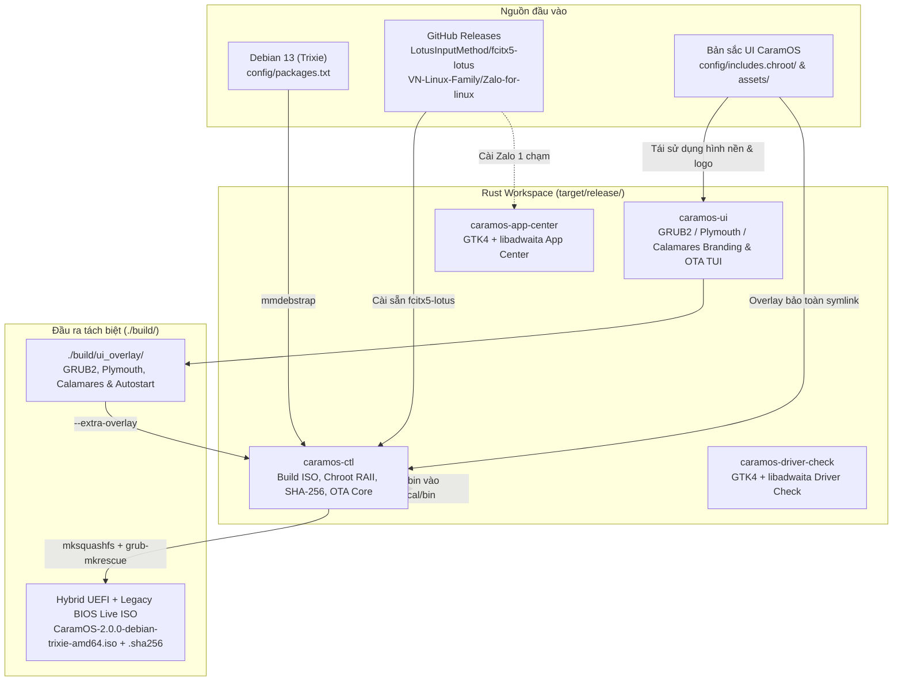

<p align="center">
  
</p>

<h1 align="center">CaramOS Testing — Debian 13 (Trixie) &amp; Rust Core</h1>

<p align="center">
  Nhánh phát triển và thử nghiệm tái cấu trúc hạ tầng cho <strong>CaramOS (VNLF)</strong>: dựng hệ thống trực tiếp từ Debian 13 (Trixie), thay thế toàn bộ các script Python và Bash rời rạc bằng công cụ Rust an toàn bộ nhớ, đồng thời giữ trọn vẹn giao diện và trải nghiệm đặc trưng của CaramOS.
</p>

<p align="center">
  
  
  
  
</p>

> [!WARNING]
> **Trạng thái dự án — Đang trong giai đoạn thử nghiệm & hoàn thiện (Work in Progress)**
> Kho mã nguồn này (`CaramOS-testing`) là nhánh fork kỹ thuật nhằm kiểm chứng mô hình **Debian 13 trực tiếp + Rust backend** trước khi đề xuất đóng góp lại cho dự án gốc **CaramOS của cộng đồng VNLF (VN-Linux-Family)**. Một số tính năng vẫn đang tiếp tục tinh chỉnh và kiểm thử trên nhiều dòng phần cứng thật. Khuyến nghị chạy thử trên **QEMU / VirtualBox** hoặc Live USB trước khi cài đặt lên máy làm việc chính.

---

## 1. Mục tiêu của nhánh tái cấu trúc

Nhánh này tập trung giải quyết bài toán kỹ thuật ở tầng xây dựng ISO và các ứng dụng hệ thống của CaramOS, giữ nguyên trải nghiệm quen thuộc mà người dùng Việt yêu thích ở bản gốc:

- **Gỡ bỏ phái sinh chồng chéo 3 tầng (`Debian → Ubuntu → Linux Mint → CaramOS`)**: Khởi tạo rootfs trực tiếp từ kho thượng nguồn **Debian 13 (`trixie`)** bằng `mmdebstrap` với danh sách gói kiểm soát chặt trong `config/packages.txt` — gọn nhẹ, sạch sẽ và dễ bảo trì lâu dài.
- **Thay thế hoàn toàn Python & Bash bằng Rust Workspace**: Toàn bộ trình điều phối đóng gói ISO, quản lý `chroot`, bộ đồng bộ nhận diện thương hiệu, cập nhật OTA, **Trung tâm Ứng dụng (App Center)** và **Kiểm tra Driver (Driver Check)** đều viết bằng Rust (`#![forbid(unsafe_code)]`, Clippy chặn `.unwrap()`/`.expect()`/`panic!`, không gọi `sh -c`).
- **Giữ nguyên bản sắc UI của CaramOS**: Không tự vẽ hình nền giả. `caramos-ui` tái sử dụng trực tiếp hình nền có sẵn trong `config/includes.chroot/usr/share/backgrounds/` và logo `assets/CaramOS_logo.png` cho GRUB2, Plymouth và Calamares; bộ ứng dụng Desktop dùng font **Be Vietnam Pro**, hỗ trợ chế độ **Sáng (Sage Mist) / Tối (Indigo Night)**, đồng bộ với lớp phủ Cinnamon gốc trong `config/includes.chroot/`.
- **Dùng Calamares GUI chính thức của Debian 13**: Hỗ trợ cài song song (Dual-boot Windows), chia phân vùng đồ họa, mã hóa đĩa LUKS, mặc định tạo tài khoản người dùng thường (`sudo`) và khóa đăng nhập `root`.

---

## 2. Kiến trúc tổng thể (3 Crates — 4 Binary Rust)



---

## 3. Chi tiết các thành phần cốt lõi

### 3.1. `caramos-ctl` (`crates/caramos-ctl`) — Điều phối đóng gói ISO & hệ thống
- Kiểm tra công cụ máy chủ và khóa OpenPGP Debian (`debian-archive-keyring`) trước khi chạy `mmdebstrap`.
- Quản lý vòng đời chroot bằng RAII (`ChrootMountGuard`, `ChrootPolicyRcGuard`, `ChrootResolvConfGuard`).
- Tải và xác thực SHA-256 gói `fcitx5-lotus_*_amd64_trixie.deb` trực tiếp từ GitHub Releases bằng Rust (`ureq`), thiết lập sẵn tiếng Việt (`vi_VN.UTF-8`), múi giờ `Asia/Ho_Chi_Minh`, `uinput`, phím chuyển `Ctrl+Shift` và kho Flathub.
- Chuyển Calamares của `calamares-settings-debian` sang `branding: caramos`, bảo toàn 100% symlink của `config/includes.chroot/`, biên dịch `glib-compile-schemas` / `dconf` / `plymouth` / `initramfs` và xuất **Hybrid UEFI + BIOS ISO** bằng `grub-mkrescue`.

### 3.2. `caramos-ui` (`crates/caramos-ui`) — Đồng bộ Branding & OTA TUI
- **`branding`** *(alias `bootloader`)*: Tự quét hình nền sẵn có trong `config/includes.chroot/usr/share/backgrounds/` và logo `assets/CaramOS_logo.png` để chuẩn hóa ảnh PNG cho GRUB2, Plymouth, Calamares (`branding.desc`, 4 slide Qt6 `show.qml`, chính sách `users.conf` khóa `root`) cùng các tệp `.desktop` / `autostart` vào thư mục tạm `./build/ui_overlay` (không làm bẩn Git).
- **`updater`**: Cập nhật tệp hệ thống nguyên tử theo luồng (`64 KiB` bộ đệm), xác thực SHA-256 phần cứng (`sha2`), đồng bộ `fsync` + `rename` nguyên tử và tự động khôi phục khi gặp lỗi.

### 3.3. `caramos-desktop` (`crates/caramos-desktop`) — Bộ ứng dụng Desktop GTK4 + libadwaita
- **`caramos-app-center` (Trung tâm Ứng dụng CaramOS)**:
  - Giao diện một trang chia 4 nhóm quen thuộc: **Liên lạc & Họp trực tuyến** (**Zalo Desktop** native từ `VN-Linux-Family/Zalo-for-linux`, Telegram, Zoom, Teams, Discord), **Bộ văn phòng** (ONLYOFFICE, LibreOffice tiếng Việt, WPS Office), **Trình duyệt** (Firefox ESR, Chrome, Brave, Edge) và **Tiện ích hằng ngày** (Font chuẩn Microsoft, VLC, OBS Studio, RustDesk, GIMP, Thunderbird).
  - Hiển thị ưu/nhược điểm, dung lượng, nguồn gói, tích sẵn bộ đề xuất, nút **Gỡ bỏ** trên từng thẻ đã cài, liên kết `apps.vietnamlinuxfamily.net` và tự mở 1 lần sau khi cài đặt (`--first-boot`).
  - Gom toàn bộ gói APT/`.deb` vào **1 lần xác thực `pkexec` duy nhất** qua tham số đã kiểm định, không gọi `sh -c`.
- **`caramos-driver-check` (Kiểm tra Driver CaramOS)**:
  - Quét trực tiếp `/sys/bus/pci/devices`, `lspci`, log firmware kernel (`journalctl`/`dmesg`), `/etc/modprobe.d/`, trạng thái **Secure Boot** và `cups` cho 4 nhóm: **Wi-Fi, Đồ họa, Âm thanh, Máy in**.
  - Hiển thị chẩn đoán rõ ràng bằng tiếng Việt (Hoạt động tốt, Chưa có driver, Thiếu firmware, Bị chặn Blacklist/Secure Boot, Chờ khởi động lại), cài gói Debian 13 đề xuất bằng 1 cú bấm, xuất báo cáo phần cứng ra `~/Desktop/caramos-hardware-report.txt` và tự động chạy khi boot Live USB (`--autostart`).

---

## 4. Cấu trúc kho mã nguồn

```text
CaramOS-testing/
├── .github/workflows/ci.yml   # CI: Chặn commit nhị phân, Clippy, Test, Dry-Run & Build Hybrid ISO
├── Cargo.toml                 # Cargo Workspace gốc cho cả 3 crate
├── Makefile                   # Lệnh chuẩn hóa (all, stage-ui, dry-run, build, release, clean)
├── assets/                    # Logo và tài nguyên thương hiệu gốc của CaramOS
├── config/
│   ├── includes.chroot/       # Lớp phủ UI CaramOS (Cinnamon, hình nền, theme, icon, font)
│   └── packages.txt           # Danh sách gói Debian 13 (Trixie) cho Live ISO, Calamares & GTK4
├── crates/
│   ├── caramos-ctl/           # Bộ build Hybrid ISO, cài fcitx5-lotus & quản lý Chroot RAII
│   ├── caramos-ui/            # Đồng bộ branding GRUB2/Plymouth/Calamares & OTA TUI
│   └── caramos-desktop/       # Ứng dụng GUI GTK4/libadwaita: caramos-app-center & caramos-driver-check
└── docs/                      # Tài liệu thiết kế kỹ thuật
```

---

## 5. Hướng dẫn build & kiểm thử cục bộ

### Bước 1: Cài đặt thư viện & công cụ trên máy build (Debian / Ubuntu)

```bash
sudo apt-get update && sudo apt-get install -y \
    libgtk-4-dev libadwaita-1-dev pkg-config \
    mmdebstrap debian-archive-keyring squashfs-tools xorriso \
    grub-common grub-pc-bin grub-efi-amd64-bin \
    mtools dosfstools ca-certificates
```

*(Yêu cầu Rust toolchain ổn định >= 1.85 kèm `clippy` và `rustfmt`.)*

### Bước 2: Kiểm tra mã nguồn, chạy test & xem thử ứng dụng GTK4

```bash
# Chạy Clippy nghiêm ngặt, Unit Tests và biên dịch đủ 4 binary release
make all

# Kiểm tra tạo overlay branding từ hình nền sẵn có và chạy mô phỏng pipeline ISO
make dry-run

# Chạy thử trực tiếp App Center & Driver Check trên máy hiện tại
./target/release/caramos-app-center
./target/release/caramos-driver-check
```

### Bước 3: Đóng gói ảnh Live ISO Hybrid UEFI/BIOS

```bash
make build      # Nén SquashFS nhanh bằng Zstandard (phù hợp phát triển & test)
make release    # Nén SquashFS tối đa bằng XZ (phù hợp phát hành)
```

Ảnh ISO xuất tại `./build/CaramOS-2.0.0-debian-trixie-amd64.iso` kèm `./build/CaramOS-2.0.0-debian-trixie-amd64.iso.sha256`.

### Bước 4: Kiểm thử boot trên QEMU (BIOS & UEFI)

```bash
# Legacy BIOS
qemu-system-x86_64 -enable-kvm -m 4096 -smp 2 \
    -cdrom build/CaramOS-2.0.0-debian-trixie-amd64.iso

# UEFI (cần cài gói ovmf)
qemu-system-x86_64 -enable-kvm -m 4096 -smp 2 \
    -bios /usr/share/ovmf/OVMF.fd \
    -cdrom build/CaramOS-2.0.0-debian-trixie-amd64.iso
```

---

## 6. Tiến độ hiện tại & Hạng mục đang hoàn thiện

- [x] Chuyển toàn bộ chuỗi công cụ build và ứng dụng hệ thống sang Cargo Workspace Rust (`#![forbid(unsafe_code)]`).
- [x] Dựng rootfs trực tiếp từ Debian 13 (Trixie), đóng gói Hybrid UEFI + Legacy BIOS ISO bằng `grub-mkrescue` và xác thực El Torito/EFI trên GitHub Actions.
- [x] Tích hợp trình cài đặt đồ họa Calamares của Debian 13 với bộ nhận diện CaramOS tái sử dụng hình nền và logo có sẵn, mặc định tài khoản user thường và khóa `root`.
- [x] Tích hợp sẵn bộ gõ tiếng Việt **Fcitx5 + Lotus** (`Ctrl+Shift`) và kho Flathub.
- [x] Tái dựng **CaramOS App Center** (hỗ trợ cài 1 chạm Zalo native VNLF, ONLYOFFICE, trình duyệt, tiện ích) và **CaramOS Driver Check** bằng GTK4 + libadwaita với backend 100% Rust.
- [x] Tách sạch `target/`, `./build/` và toàn bộ tệp nhị phân khỏi Git kèm CI Guard tự động.
- [ ] Kiểm thử toàn diện cài đặt Calamares Dual-boot Windows & phần cứng thực tế (laptop Wi-Fi Realtek/Broadcom, GPU NVIDIA + Secure Boot).
- [ ] Tinh chỉnh thêm cấu hình Cinnamon Control Center & các gói nhỏ cho trải nghiệm ổn định tương đương bản chính thức.
- [ ] Hoàn thiện luồng cập nhật OTA end-to-end từ máy chủ phát hành thực tế.
- [ ] Đề xuất đóng góp các cải tiến ổn định ngược về kho chính thức của **CaramOS (VNLF)**.

---

## 7. Ghi nhận & Đóng góp

- Dự án gốc: **CaramOS — VN Linux Family (VNLF)** ([caramos.vietnamlinuxfamily.net](https://caramos.vietnamlinuxfamily.net)). Nhánh này kế thừa và tôn trọng trọn vẹn định hướng thiết kế, bộ tài nguyên và cộng đồng của CaramOS.
- Mọi báo lỗi khi build/boot ISO, kết quả chạy thử trên máy ảo hoặc phần cứng thật và Pull Request cải tiến Rust đều rất được hoan nghênh qua mục **Issues** và **Pull Requests** (xem thêm [CONTRIBUTING.md](CONTRIBUTING.md)).

---

## 8. Giấy phép

Dự án được phân phối dưới giấy phép **GNU General Public License v3.0**. Xem tệp [LICENSE](LICENSE) để biết chi tiết.
